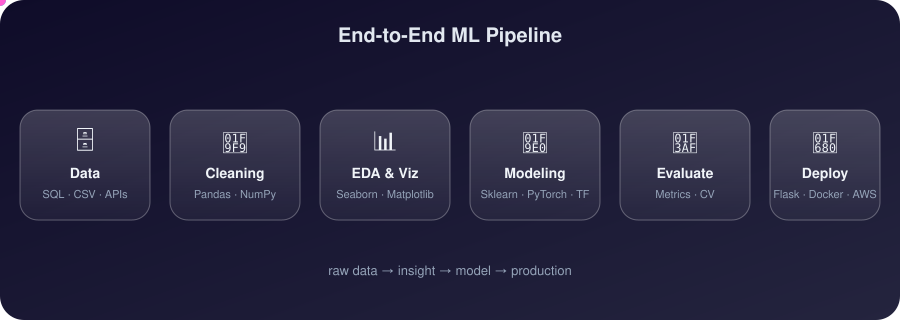
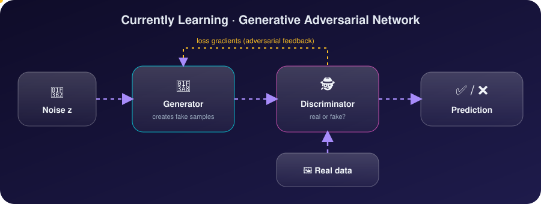
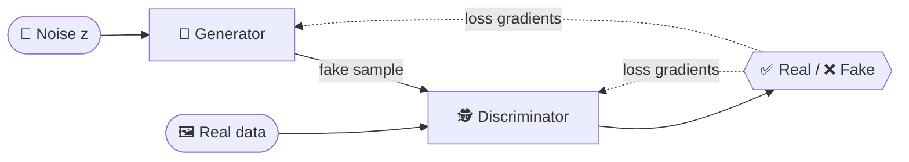

 

 

## 🌌 About Me

<table>
<tr>
<td width="50%" valign="top">

### 🌱 Currently learning
**Generative Adversarial Networks**

### 💬 Ask me about
`Python` · `Data Analytics` · `Data Visualization` · `Machine Learning` · `Deep Learning`

</td>
<td width="50%" valign="top">

### 📫 Reach me
**[raghav.balansh@gmail.com](mailto:raghav.balansh@gmail.com)**

### 📄 My experience
**[workingonit.com](https://workingonit.com)**

</td>
</tr>
</table>

 

## 🔗 Connect With Me

 

## 🧬 How I Work — End-to-End ML Pipeline

 

## 🎨 Currently Exploring — GAN Architecture

<b>🔍 Same idea as a Mermaid diagram (click to expand)</b>

 

## 📈 Skill Graph

 

## 🛠️ Languages & Tools

&nbsp;&nbsp;
&nbsp;&nbsp;
&nbsp;&nbsp;
&nbsp;&nbsp;
&nbsp;&nbsp;
&nbsp;&nbsp;

  
&nbsp;&nbsp;
&nbsp;&nbsp;
&nbsp;&nbsp;
&nbsp;&nbsp;
&nbsp;&nbsp;
&nbsp;&nbsp;
&nbsp;&nbsp;
&nbsp;&nbsp;
&nbsp;&nbsp;

 

## 📊 GitHub Stats

 

 

## 🐍 Contribution Snake

<picture>
  <source media="(prefers-color-scheme: dark)" srcset="https://raw.githubusercontent.com/raghav-balansh/raghav-balansh/output/snake-dark.svg"/>
  <source media="(prefers-color-scheme: light)" srcset="https://raw.githubusercontent.com/raghav-balansh/raghav-balansh/output/snake.svg"/>
  
</picture>

 

*Always learning · always building* ✨

